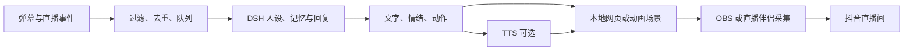

# B站、抖音自主运营工具与互动直播分析

调查日期：2026-10-26。依据：用户给出的两个视频标题、GitHub 仓库、直播截图及公开源码。B站两个视频页面和公开信息接口被访问限制，未获得视频全文或字幕，因此不声称逐段观看或确认全部演示细节。

## 1. 视频与源码对应

| 视频 | 用户补充的标题 | 对应调查入口 |
| --- | --- | --- |
| [BV1bwnF6eEe8](https://www.bilibili.com/video/BV1bwnF6eEe8/) | 我做了个开源工具，让大肥鱼当上了B站UP主（这条视频就是她自己投的） | 用户补充 [kukemc/bili-cli](https://github.com/kukemc/bili-cli) |
| [BV1riHT67Efc](https://www.bilibili.com/video/BV1riHT67Efc/) | dsh插件，让你的大肥鱼在抖音也能自主运营 | 用户补充 [himengxue/my-code](https://github.com/himengxue/my-code) |

关联按用户提供的标题和仓库判断；没有视频字幕证据，不进一步断言视频录制时的版本与当前仓库完全一致。调查固定提交分别为 `e603eeb86cc0c43c362d7d0a3be6327dba54c375` 和 `d45027ed98e9954172d3b2876a2672d455fc8835`。本项目没有安装或运行这两套工具。

## 2. bili-cli：给 Agent 一套 B站操作命令

它的主体是 Python CLI，发行包名 `bili-agent`，命令名 `bili`。DSH 可以通过 Skill 学会调用命令；另有 MCP 入口。DSH 负责理解任务与决定下一步，CLI 负责登录态、平台请求、结构化结果与错误，不需要重新开发 Agent 循环。

已读 [README](https://github.com/kukemc/bili-cli/blob/e603eeb86cc0c43c362d7d0a3be6327dba54c375/README.md)、[依赖声明](https://github.com/kukemc/bili-cli/blob/e603eeb86cc0c43c362d7d0a3be6327dba54c375/pyproject.toml)、[投稿实现](https://github.com/kukemc/bili-cli/blob/e603eeb86cc0c43c362d7d0a3be6327dba54c375/src/bili_cli/commands/upload.py)和 [MCP 实现](https://github.com/kukemc/bili-cli/blob/e603eeb86cc0c43c362d7d0a3be6327dba54c375/src/bili_cli/mcp_server.py)。代码通过 `bilibili-api-python` 等库完成账号操作；投稿接收已有视频文件，并设置投稿信息。AI 声明有默认开启的选项。

它值得复用的部分是统一 JSON、账号操作接口、错误处理和只读/写操作边界。它不等于通用视频生成器，也不自带本项目要求的飞书按版本审批。接入时应保留审核授权层，并逐项核对所需能力在 CLI 与 MCP 两个入口的覆盖。

## 3. my-code：原生插件连接 Python/Node 执行器

仓库包含 `douyin-assistant/` 运行时和 `dsh-plugin/` 宿主包装。后者注册 Skill、六个 `douyin_*` 工具与设置页；底层执行器保留策略、去重与提交记录。参考 [插件说明](https://github.com/himengxue/my-code/blob/d45027ed98e9954172d3b2876a2672d455fc8835/dsh-plugin/README.md)与 [插件源码](https://github.com/himengxue/my-code/blob/d45027ed98e9954172d3b2876a2672d455fc8835/dsh-plugin/lib/index.js)。

其中的视频制作采用本地文字/图形渲染与编码：分镜交给 Pillow、FFmpeg 组成竖屏无声视频和封面。这里不需要逐帧调用 Seedance。运行时通过专用浏览器与 CDP 完成网页交互；这也解释了普通创作者账号能够操作自己的创作者中心，不能据此推定获得抖音官方 OAuth 投稿权限。

审核该候选时有三点边界：

- 对外主要入口是 `douyin_video`，现有证据针对视频，不能据此把抖音多图发布标为已支持。
- 作者的 [发布审计](https://github.com/himengxue/my-code/blob/d45027ed98e9954172d3b2876a2672d455fc8835/douyin-assistant/RELEASE_AUDIT.md)记录一次 Windows CLI 发布；评论回复遇短信验证，旧成功判断已被纠正。该记录是作者证据，本项目未复测。
- [DSH 兼容说明](https://github.com/himengxue/my-code/blob/d45027ed98e9954172d3b2876a2672d455fc8835/douyin-assistant/DSH_COMPATIBILITY.md)与新增插件 README 的表述存在时间差：前者描述 Skill/runtime，后者已提供插件。宿主发现、工具注册、真实模型会话和平台投稿必须分开验收。

现有 `policy.json` 管的是执行器权限范围。我们还需要“飞书某审核人批准某版本”这一条授权记录，以及批准后的受控派发，不能只打开发布开关来代替。

## 4. 截图中的直播

截图直接可见：固定小店背景、角色立绘、对话气泡、字幕/弹幕、音乐栏、时钟、token/口粮计数及平台礼物浮层。截图不能证明角色使用 Live2D，不能确认是否有语音，也不能识别作者的弹幕接口、TTS 供应商、推流程序或完整后台。

可以复现相近效果的一条技术链路如下，属于设计推断，不是该主播实现的确认：

背景、时钟、计数器、立绘和字幕可以直接由 HTML/CSS/Canvas 渲染。角色运动可以用少量循环素材、序列帧或 Live2D；说话时更新气泡、切表情，语音启用时再播放 TTS。OBS 的 [Browser Source 官方说明](https://obsproject.com/kb/browser-source)明确支持网页中的布局、图像、视频和音频作为采集源。

已有同类源码可佐证这种拆法：[luckui/dsh-livestream](https://github.com/luckui/dsh-livestream)公开描述 DSH 对接 B站直播消息、豆包 TTS、角色动画与 OBS。它针对 B站，不能直接视为抖音支持，更不能据此认定截图主播使用了它。[fore-vip/dsh-live](https://github.com/fore-vip/dsh-live)公开的是采集与 FFmpeg 推流层，仍不等于完整 AI 主播。

截图的“口粮”更可能是应用把 token 消耗/额度映射成的人设指标，但负数、兑换比例、与礼物的关系均不能从截图确认。声音、动画和回复可以事件驱动；模型无需按直播画面每一帧运行。成本取决于被处理的消息量、上下文、模型和语音量，而非直播分辨率对应的视频生成次数。

## 5. 对内卷树懒的取舍

1. 首期仍保持抖音图文审批闭环。本次新增的是依赖证据，不自动把视频、B站运营或直播写入已批准范围。
2. `my-code` 优先作为 DSH 注册方式、浏览器隔离、发布记录与恢复处理的学习参考；图文仍需单独补能力与实测。
3. `bili-cli` 可成为未来 B站适配器或独立工具产品的参考，CLI + Skill 已可接入可执行命令的 DSH；确有跨宿主需求再使用其 MCP。
4. 直播另立后续切片，先用测试消息驱动本地场景，再接真实直播事件和推流。它不需要提前建设视频生成 MCP。
5. 商用角色使用自己的树懒素材。以 `dsh-livestream` 为例，代码和所附角色动画的许可证不同，不能把代码许可直接套到角色素材。

若复用抖音执行器，`douyin_video.publish` 和通用浏览器写操作应留在可信执行侧，创作会话只拿草稿能力。直接整包装入创作 preset 会与本项目“只有审核任务才能投稿”的边界冲突，需要在组合与适配器处落实。
