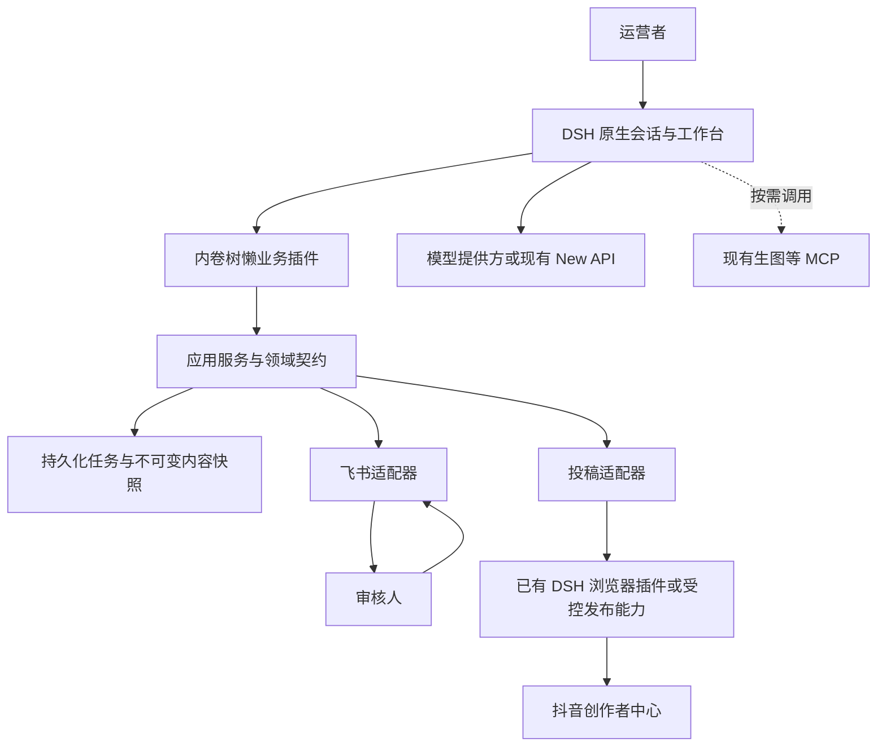

# 架构与设计决策

版本：`0.1.0-draft.1`；日期：2026-10-26；状态：候选设计。此文记录实现取舍，行为与字段以 SDD 和 Schema 为准。

## ARC-01 系统边界



首期运行在一个本机实例内。没有第二套 Agent 循环，没有强制的独立 FastAPI 业务网关；飞书的消息接收传输按真实能力选型，不因图中画一条箭头就视为已完成。

## ARC-02 各层职责

| 层 | 应承担 | 不应承担 |
| --- | --- | --- |
| DSH 运行时 | 会话、模型路由、工具生命周期、原生交互 | 替业务决定是否审核通过 |
| 业务插件 / Controller | 注册工具和界面、转换参数、传入可信身份 | 自行拼平台请求、直接修改业务存储 |
| Application Service | 版本校验、审核规则、状态转换、任务调度 | 依赖飞书/抖音具体 SDK 类型 |
| Domain Ports | 以业务语言描述存储、审核、投稿能力 | 泄漏 DOM 选择器、Cookie、数据库连接 |
| Infrastructure Adapter | SDK、浏览器、存储、MCP 调用与错误转换 | 省略应用服务的审核校验 |

依赖方向：`Controller → Application → Domain Ports ← Infrastructure`。同一个进程也保持此方向。

## ADR-01 DSH 是主体

决策提案：优先依托 DSH 原生插件。插件使用 TypeScript，具体 SDK 和版本待探测后固定。未来 Python MCP 使用 `uv`；没有 Python 实现时不创建空的环境文件。

原因：学习目标是掌握 DSH 插件与工具组合；重建聊天产品会偏离目标。代价：必须维护宿主版本兼容性。退出方案：业务服务不直接依赖 DSH，可替换 Controller。

## ADR-02 Plugin、Skill、MCP 分别使用

- Plugin：在宿主注册功能，并管理配置、状态和生命周期。
- Skill：让模型按规则使用已有能力，不能单靠提示词约束写权限。
- MCP：外部工具的协议边界；已有原生插件能完成的能力无需强行再次包裹。

首期审核和投稿授权位于业务插件；模型可见的工具只处理草稿和查询。最终投稿适配器只允许可信后台执行器调用，不向创作 Agent 挂载无审核的通用发布能力。

仅隐藏一个 publish 工具并不足以构成隔离：创作 preset 若仍能任意执行 shell、浏览器或编辑审批数据库，也能绕过流程。真实发布运行时必须使用受限 preset；开发者的插件开发会话使用独立 DSH home / profile 与测试账号。

## ADR-03 任务开始时选择能力组合

候选分为创作和可信发布执行两类职责，不默认启用多 Agent。DSH 官方 preset 文档说明运行中 Agent 的组合保持稳定；因此首期按任务边界选择 preset，不承诺对同一 Agent 任意热切换人设和权限。

飞书批准后由程序派发持久化任务，不能只往聊天中追加“用户已同意”一句话。发布过程可以调用浏览器工具，但是否有权发布由程序校验。

## ADR-04 审核渠道优先飞书应用机器人

普通群 Webhook 主要用于推送，不能据此实现可信按钮回调。首期采用自建应用机器人；HTTP 回调或长连接由集成验证决定，不能假设所有事件都支持相同传输。

凭据仅供飞书适配器读取。原始事件先验证来源，再提取实际组织、操作者、消息与动作。模型提交的 JSON 不能创建可信审核身份。

## ADR-05 单机持久化与恢复

候选存储为 SQLite 与受控素材目录，使用内容快照和任务记录。审核决定与唯一逻辑发布任务原子落盘；通知采用持久化待发记录，发布成功不依赖通知成功。

首期每个抖音账号最多一个活跃执行器，不支持多实例并发发布或自动主备接管。提交中失联先进入结果未知，不能因任务锁到期就允许另一进程重发。

依赖选择、事务和索引是本文件的实现建议，不作为 SDD 强制算法；满足相同行为可替换为其他存储。

## ADR-06 不承诺跨平台 exactly-once

本地可以保证一个审核对应一个逻辑任务、重复回调不重复派发。但浏览器最终点击与平台落库不共享事务，无法保证网络失败下全局恰好一次。

应采用“结果未知时不再提交＋平台证据核对”。平台作品 ID、链接、账号和审核/公开状态是证据；截图或按钮点击本身不够。

## ADR-07 复用既有投稿插件，先做能力验收

候选插件不是可信业务内核。公开的 `dsh-douyin-publish` 文档主要描述视频投稿，不证明抖音图文支持已可用；它默认停投稿前的行为与我们的流程兼容，前提是能通过受控调用在批准后执行最终提交。

如插件只能准备草稿、不能执行最终发布，或不能设置/核对 AI 声明，则视为能力不足；可补薄适配器或替换提供方，不偷偷降级为人工点发布并宣称全自动。

插件的 MIT 声明只适用于对应代码；浏览器、素材、模型和上游库的许可证分别核对。官方 OAuth 与网页操作是两种接入方式，网页自动化不等于获得官方 API 授权。

## ADR-08 学习项目到商业工具

第一期以一个人设和一个账号验证复用边界。未来通用组件为 `draft / approval / publishing-job / receipts`；“内卷树懒”文案和视觉独立为配置，抖音与飞书分别是适配器。

商业化前另立 PRD，增加租户身份、权限、凭据隔离、配额、计费、审计导出、升级与备份、平台条款和素材授权。首期的 `workspace_id` 字段不代表上述能力已完成。

## 目录布局与后续模块提案

手册、宿主与服务的实际布局见 [目录说明](../directory-layout.md)。当前已经有 `manual/`、`dsh/` 与 `services/bilibili/`；B站目录包含固定版本的上游源码和独立运行环境，但目前以 CLI 进程提供能力，尚无长驻 HTTP MCP 服务。以下业务模块仍是提案，尚未生成：

```text
plugins/
  dsh-cyber-sloth/       # 自研 DSH 插件，独立于 dsh/ 上游源码
services/
  workflow/             # 审核、任务编排、单机存储与素材快照
  feishu/               # 飞书推送与已验证事件转换
  douyin/               # 既有投稿能力的受控桥接
tests/
  contracts/            # 绑定 SDD 的行为测试
  adapters/             # 假 SDK/浏览器适配测试
  integration/          # 独立的真实平台验收
```

这是一种职责组织建议，首期可以采用单包内部目录。是否拆 npm 包由真实依赖和维护需要决定，不为演示架构提前拆仓。
